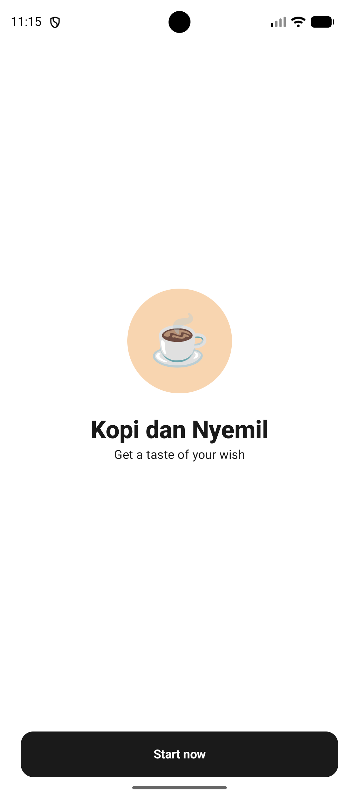
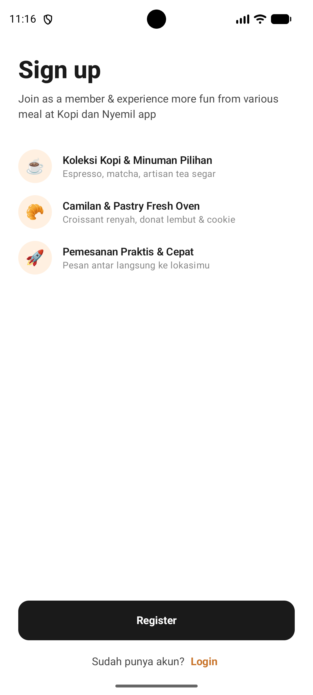
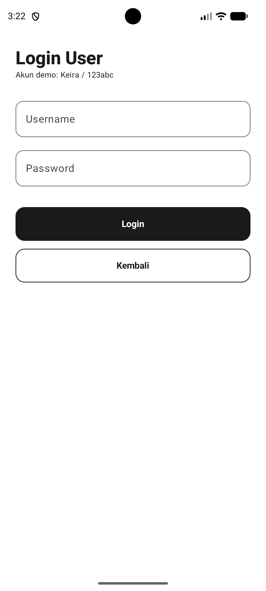
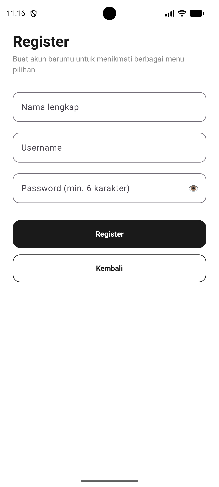
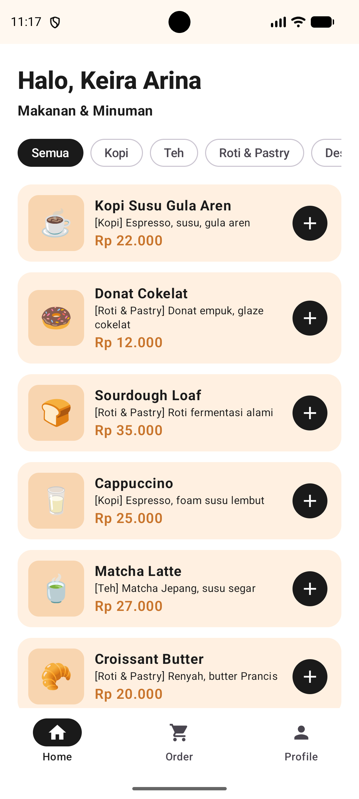
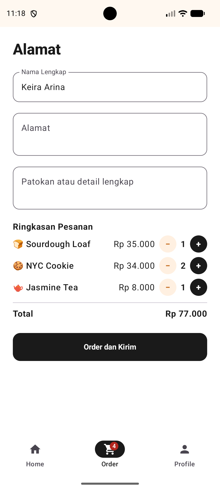
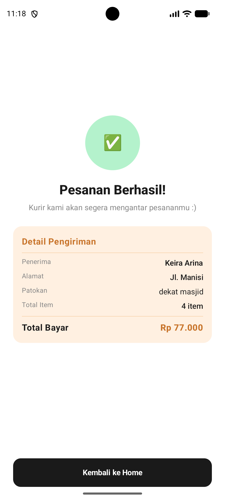
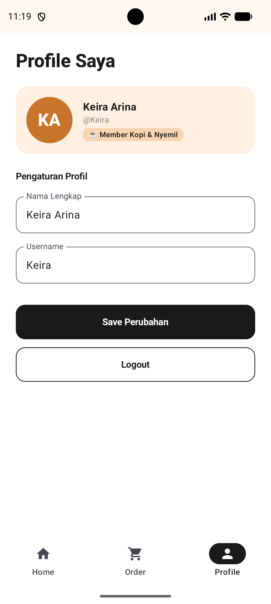
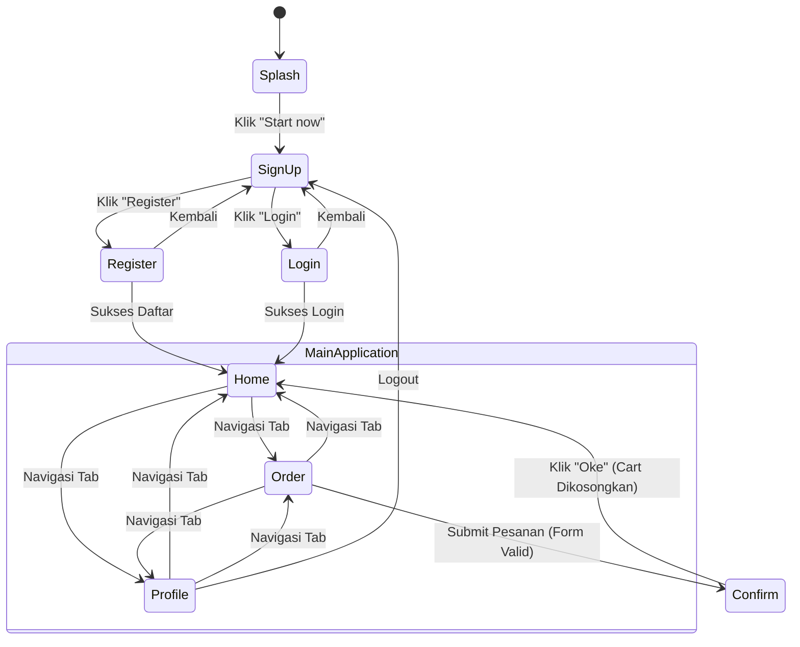

# ☕ Kopi dan Nyemil

[](https://kotlinlang.org)
[](https://developer.android.com/build)
[](https://developer.android.com/jetpack/compose)
[](https://m3.material.io)
[-informational.svg)](https://developer.android.com)
[](https://developer.android.com)

Aplikasi pemesanan makanan dan minuman berbasis Android yang dibangun secara penuh menggunakan **Jetpack Compose** dan **Material 3**. Aplikasi ini dirancang untuk memenuhi Tugas UTS mata kuliah **Pengembangan Aplikasi Mobile (PAM)** untuk mempraktikkan konsep *declarative UI*, pengelolaan *state* (State Hoisting), arsitektur navigasi, serta interaksi pengguna yang modern.

---

## 📱 Ringkasan Fitur

### 1. 🚀 Splash & Onboarding
- **Splash Screen**: Layar pembuka visual dengan logo brand dan tagline *"Get a taste of your wish"*.
- **Landing Sign Up**: Gerbang awal untuk memilih masuk (*Login*) atau membuat akun baru (*Register*).

### 2. 🔐 Autentikasi Pengguna
- **Login**: Autentikasi dengan verifikasi *username* dan *password* terhadap data pengguna yang terdaftar.
- **Register**: Pendaftaran anggota baru dengan validasi nama lengkap, keunikan *username*, serta panjang minimal *password* (min. 6 karakter).
- **Akun Demo Bawaan**: Sudah disediakan akun demo siap pakai tanpa perlu mendaftar terlebih dahulu.

### 3. 📋 Katalog Menu (Home Screen)
- Menampilkan daftar menu makanan dan minuman beragam kategori:
  - ☕ **Kopi**: Kopi Susu Gula Aren, Cappuccino
  - 🍵 **Teh**: Matcha Latte, Jasmine Tea
  - 🥐 **Roti & Pastry**: Donat Cokelat, Sourdough Loaf, Croissant Butter
  - 🍪 **Dessert**: NYC Cookie, Gelato, Dubai Chewy Cookie
- Pemformatan harga otomatis ke mata uang Rupiah (`Rp xx.xxx`).
- Tombol cepat tambah ke keranjang (*quick-add*) dengan indikator jumlah item yang langsung terupdate.

### 4. 🛒 Keranjang & Checkout (Order Screen)
- Form data pengiriman lengkap (Nama penerima, Alamat lengkap, serta Patokan/Detail alamat).
- Ringkasan pesanan dinamis (menampilkan nama item, jumlah, subtotal, tombol kurangi item `−`, dan total tagihan).
- Indikator badge pesanan pada *Bottom Navigation Bar* yang menghitung total item secara *real-time*.
- Validasi form pemesanan sebelum pesanan dikirimkan.

### 5. ✅ Konfirmasi Pesanan (Confirm Screen)
- Status konfirmasi setelah transaksi berhasil dikirim.
- Pembersihan keranjang belanja (*cart reset*) otomatis saat kembali ke halaman utama.

### 6. 👤 Profil Pengguna (Profile Screen)
- Menampilkan nama dan status pengguna aktif.
- Fasilitas untuk memperbarui nama lengkap pengguna secara langsung.
- Fitur **Logout** yang membersihkan sesi pengguna dan mengembalikan layar ke halaman autentikasi.

### 7. 🧭 Navigasi & UX Responsif
- **Bottom Navigation Bar** modern dengan indikator Material 3 dan *BadgedBox*.
- **BackHandler Support**: Menangani tombol *Back* bawaan sistem Android secara kontekstual di setiap tingkat layar.
- **Edge-to-Edge UI**: Tampilan layar penuh yang memanfaatkan seluruh area layar ponsel modern.

---

## 📸 Screenshot Tampilan Aplikasi

Berikut adalah dokumentasi antarmuka untuk seluruh 8 tampilan yang diimplementasikan sesuai ketentuan tugas:

|                           1. Splash / Welcome                           |                            2. Sign Up Landing                            |                             3. Login User                             |                                 4. Register                                 |
|:-----------------------------------------------------------------------:|:------------------------------------------------------------------------:|:---------------------------------------------------------------------:|:---------------------------------------------------------------------------:|
|  |  |  |  |

|                       5. Home (Katalog Menu)                        |                                      6. Alamat & Keranjang                                       |                              7. Konfirmasi Pesanan                               |                            8. Profil Pengguna                             |
|:-------------------------------------------------------------------:|:------------------------------------------------------------------------------------------------:|:--------------------------------------------------------------------------------:|:-------------------------------------------------------------------------:|
|  |  |  |  |

---

## 🏗️ Struktur Proyek

```
KopiDanNyemil/
├── app/
│   ├── build.gradle.kts           # Konfigurasi dependensi modul aplikasi & SDK
│   └── src/
│       ├── main/
│       │   ├── AndroidManifest.xml # Deklarasi komponen aplikasi Android
│       │   ├── java/lat/pam/kopidannyemil/
│       │   │   ├── MainActivity.kt # Entry point, AppState, deklarasi Screen & root composable
│       │   │   ├── Models.kt       # Data class User, MenuItem, dummyMenu, & helper Rupiah
│       │   │   └── ui/
│       │   │       ├── AuthScreens.kt  # Composable SplashScreen, SignUp, Login, & Register
│       │   │       ├── MainScreens.kt  # Composable HomeScreen, OrderScreen, ProfileScreen, ConfirmScreen, BottomBar
│       │   │       ├── Components.kt   # Komponen reusable (PrimaryButton, OutlineButton, AppField, ErrorText)
│       │   │       └── theme/
│       │   │           ├── Color.kt    # Palet warna aplikasi (Caramel, Cream, Peach, Ink, dsb.)
│       │   │           ├── Theme.kt    # Tema Material3 KopiDanNyemilTheme
│       │   │           └── Type.kt     # Pengaturan Tipografi
│       │   └── res/                # Aset ikon dan konfigurasi XML
├── screenshots/                    # Tangkapan layar antarmuka aplikasi untuk dokumentasi
├── gradle/
│   ├── libs.versions.toml          # Gradle Version Catalog (manajemen versi terpusat)
│   └── wrapper/                    # Gradle Wrapper
├── build.gradle.kts                # Root build script
├── settings.gradle.kts             # Konfigurasi repositori dan modul
└── README.md                       # Dokumentasi proyek
```

---

## 🔄 Alur Navigasi Aplikasi



---

## 🔑 Kredensial Akun Demo

Untuk memudahkan proses pengujian dan evaluasi, akun demo berikut sudah terdaftar di dalam aplikasi:

| Parameter    | Kredensial |
|:-------------|:-----------|
| **Username** | `Keira`    |
| **Password** | `123abc`   |

> **Catatan:** Anda juga dapat menggunakan fitur **Register** untuk mendaftarkan akun baru dengan data bebas saat aplikasi berjalan.

---

## 🛠️ Teknologi & Spesifikasi

- **Bahasa Pemrograman**: [Kotlin](https://kotlinlang.org/) `2.2.10`
- **UI Toolkit**: [Jetpack Compose](https://developer.android.com/jetpack/compose) (Compose BOM `2026.02.01`)
- **Desain Sistem**: [Material Design 3 (M3)](https://m3.material.io/)
- **Minimum SDK**: API 24 (Android 7.0 Nougat)
- **Target / Compile SDK**: API 37
- **Build System**: Gradle Kotlin DSL (`build.gradle.kts`) dengan Version Catalog (`libs.versions.toml`)
- **Fitur Khusus**:
  - `androidx.activity:activity-compose`
  - `androidx.compose.material:material-icons-core`
  - `androidx.lifecycle:lifecycle-runtime-ktx`
  - In-memory reactive state management menggunakan `mutableStateOf`, `mutableStateListOf`, dan `mutableStateMapOf`

---

## 🚀 Cara Menjalankan Proyek

### Prasyarat
1. **Android Studio**: Android Studio Ladybug / Meerkat / versi terbaru yang mendukung Kotlin 2.x & AGP 9.x.
2. **JDK**: Java Development Kit versi 11 atau lebih baru (bisa menggunakan bawaan Android Studio JBR).
3. **Perangkat Uji**: Emulator Android atau perangkat fisik dengan minimal Android 7.0 (API 24) ke atas dan opsi *USB Debugging* aktif.

### Langkah Instalasi

1. **Buka Proyek di Android Studio**:
   - Buka Android Studio.
   - Pilih menu **File** > **Open**, lalu arahkan ke folder direktori `KopiDanNyemil`.
2. **Sinkronisasi Gradle**:
   - Tunggu hingga Android Studio selesai mengunduh dependensi dan melakukan **Gradle Sync**.
   - Jika diperlukan, tekan tombol **Sync Project with Gradle Files** (ikon gajah dengan panah biru).
3. **Jalankan Aplikasi**:
   - Pilih target perangkat/emulator pada toolbar atas.
   - Klik tombol **Run 'app'** (`Shift` + `F10` atau tombol ikon *Play* hijau).

### Menjalankan Melalui Terminal / CLI

Untuk melakukan build APK Debug melalui terminal:

**Windows (PowerShell/CMD):**
```bash
.\gradlew.bat assembleDebug
```

**macOS / Linux:**
```bash
./gradlew assembleDebug
```

File APK yang dihasilkan akan berada pada direktori:
```
app/build/outputs/apk/debug/app-debug.apk
```

---

### 👤 Identitas Mahasiswa

| Informasi          | Keterangan                         |
|:-------------------|:-----------------------------------|
| **Nama Lengkap**   | Keira Arina Khalisha               |
| **NIM**            | 1247050056                         |
| **Kelas**          | IF B                               |
| **Mata Kuliah**    | Pengembangan Aplikasi Mobile (PAM) |
| **Dosen Pengampu** | H.,Aldy Rialdy Atmadja,M.T         |

### 📋 Pemenuhan Ketentuan Tugas

| No | Ketentuan Dosen                                                                                  |   Status   | Keterangan Implementasi                                      |
|:--:|:-------------------------------------------------------------------------------------------------|:----------:|:-------------------------------------------------------------|
| 1  | Seluruh tampilan wireframe (Splash, Sign Up, Login, Register, Home, Profile, Alamat, Konfirmasi) | ✅ Selesai | 8 layar terimplementasi penuh dengan Compose                 |
| 2  | Menggunakan data statis / dummy (tanpa database)                                                 | ✅ Selesai | In-memory reactive state (`AppState`, `dummyMenu`, `User`)   |
| 3  | Desain modern, menarik, dan mudah digunakan                                                      | ✅ Selesai | Desain bertema *warm cafe* berbasis Material 3               |
| 4  | Bottom navigation (opsional/fleksibel)                                                           | ✅ Selesai | `NavigationBar` dengan indikator badge keranjang dinamis     |
| 5  | Daftar makanan/minuman minimal 5 item                                                            | ✅ Selesai | Terdapat 10 item menu berkategori (Kopi, Teh, Roti, Dessert) |
| 6  | README berisi deskripsi, fitur, teknologi, cara running, & screenshot                            | ✅ Selesai | Terdokumentasi lengkap dalam file `README.md`                |

---

## 📄 Lisensi

Proyek ini dibuat untuk keperluan pendidikan dan akademik. Kode sumber bersifat terbuka untuk dipelajari dan dikembangkan lebih lanjut.
